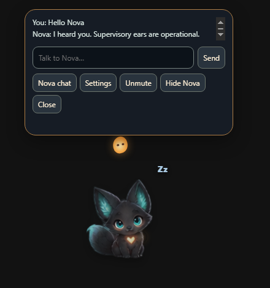
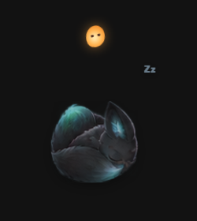

# Nova Fox Companion

An evolving fork of [Codex Avatars](https://github.com/Kajdrak2/Codex-avatars) with an original spirit fox, floating spirit chat controls, optional speech, GPT model selection, encrypted memory, fullscreen avoidance, and playful desktop behavior. See [Nova Fox Companion development notes](docs/nova-fox-companion.md) for implemented behavior and validation limits. Nova uses its own plugin, hook marker, named pipe, and startup identifiers. Existing upstream integration is not modified.

Try the isolated renderer preview with `npm run preview:nova -- --scene=chat`. It uses synthetic data and makes no model calls or changes to Codex hooks. Other preview scenes: `sleep`, `peek`, `play`, `escape`, `fullscreen`.

## Codex compatibility

Use **Codex connection** in settings to choose an existing Codex home, or follow CODEX_HOME/the standard default. Nova stores its own settings, keys, and memory separately. Hook installation is explicit and targets only that home; conflicts with the original Avatars integration are reported. [Compatibility checks and validation limits](docs/nova-fox-companion.md#codex-connection-settings-and-compatibility-validation).

## Nova Fox Companion

Nova Fox Companion gives the main task and every Codex subagent an independent animated companion. Characters use the native Codex Pet v2 format and roam directly across one or more displays, with no dock, colored panel, or visible overlay background.

> **Development fork; no public Nova release or installer is published.** Package version `0.7.2` comes from the inherited Codex Avatars baseline. Nova-specific changes are [Unreleased](CHANGELOG.md); local `0.7.2-handoff.*` packages identify reviewed development bundles, not GitHub releases. The newest local handoff is .3, with unresolved visual movement/scaling issues in [known issues](docs/known-issues.md). See the [development notes](docs/nova-fox-companion.md) for exact verification limits.

[Lire en français](README.fr.md)

## Take a look



*Synthetic renderer preview with sample chat text.*



*Sleep preview. These genuine captures show the current artwork and renderer; they do not certify native movement or gaming performance. [Capture details](docs/images/README.md).*

## Features

- A genuinely invisible overlay: only avatars and optional labels are drawn.
- One independent character per `agent_id`, including the main agent.
- Native Codex Pet v2 movement, working, waiting, and completion animations.
- Enable or disable avatars discovered under `~/.codex/pets`.
- Automatically detect avatars created from ChatGPT Work or Codex.
- Roam through the actual Windows display arrangement, crossing only shared screen edges and intermediary monitors.
- Draw custom roaming rectangles directly on the desktop, like a screenshot selection.
- Show each main Codex task title and the real collaboration subtask name, plus optional model and reasoning effort.
- Size main agents and subagents independently.
- Preview both avatar sizes live while dragging their controls.
- Optionally keep recently idle or completed agents visible as stationary sleeping Pets for up to 30 minutes.
- Delayed lifecycle end events cannot resurrect an expired sleeping avatar.
- Create a tailored Pet from the settings form in a prefilled Codex task.
- Browse, search, preview, and directly install deduplicated V2 Pets from the controlled Codex Avatars catalog fork and the original Awesome Codex Pet catalog.
- Validate and submit a selected local V2 Pet directly to the catalog through GitHub, without spending Codex credits.
- Report a published Pet from its marketplace card through a prefilled public GitHub issue.
- Open a guided GitHub bug report or feature suggestion directly from the app, with the installed version filled in automatically.
- Import and share validated `.codexpet` packages through the local Pet Gallery.
- Escape passive mode from settings, the Windows tray icon, or `Ctrl+Alt+A`.
- Hide or restore every avatar from settings or the tray without closing the companion.
- Start on the first Codex session event, with login startup as a fallback.
- Local, metadata-minimized event transport.

## Why a local renderer is still required

The plugin owns the ChatGPT/Codex integration: lifecycle hooks, installation, commands, and avatar creation. Plugin UI runs inside an iframe in ChatGPT, so it cannot create an operating-system window above unrelated applications.

A local Electron process therefore draws the desktop sprites. A packaged installer can bundle that runtime; the current source setup requires the installed development tools described below. No Nova installer is published yet.

## Installer status

This fork has no downloadable release yet. Use the source-development instructions below or an explicitly reviewed local handoff; upstream installers do not contain the Nova-specific changes. The inherited packaging workflow can build a self-contained installer, but publication, signing, installer behavior and fresh-machine acceptance require a separate review. See [release preparation](docs/releasing.md).

The setup/installer paths can register local integration, install hooks and start the companion. Review those actions and Codex's hook trust prompt before using them. Rendering a synthetic preview requires none of that integration.

When a newer GitHub release is available, the companion offers to open its release page on startup. Updates remain user-mediated: download and run the normal installer rather than allowing a silent executable replacement.

## Install from Git — development

Requirements: Windows 10/11, Node.js 22 or newer, and a current ChatGPT desktop app with Codex.

```powershell
git clone https://github.com/ThornsOfire/nova-fox-companion.git nova-fox-companion
cd nova-fox-companion
powershell -ExecutionPolicy Bypass -File .\install.ps1
```

The setup script installs locked dependencies, registers this checkout as a local Codex marketplace, attempts to install `nova-fox-companion@nova-fox-companion-local`, records the source renderer path, and starts it in the background.

Restart ChatGPT, open **Plugins**, choose **Nova Fox Companion Local**, enable **Nova Fox Companion**, and trust its lifecycle hooks when prompted. Non-managed hooks intentionally require this review.

Preview the setup without changing anything:

```powershell
powershell -ExecutionPolicy Bypass -File .\install.ps1 -WhatIf
```

## Use

The overlay intentionally has no panel. Open settings from the **Nova Fox Companion** icon in the Windows notification area.

- Passive mode makes every click pass through; `Ctrl+Alt+A` always remains available.
- **Disable avatars** hides the overlay while the tray process and Codex event state remain ready; use the same button or tray action to restore it instantly.
- Interactive mode lets you drag individual avatars without blocking the rest of the desktop.
- Select active Pets, separate main/subagent sizes, names, model/effort details, dormant-agent display, reduced movement, and automatic activation of newly discovered Pets.
- Choose all displays, selected monitors, or draw a custom area on the desktop; drag an avatar across an adjacent screen edge to place it there.
- Start and stop the synthetic demo from the same button.

## Community V2 marketplace

The settings window merges the controlled [Codex Avatars catalog fork](https://github.com/Kajdrak2/awesome-codex-pet) with the original [Awesome Codex Pet](https://github.com/legeling/awesome-codex-pet) catalog. The fork has priority: an identical id or exact spritesheet appears once, while assets with different hashes remain available as real variants. New original-only Pets therefore remain visible without duplicating mirrored entries. Nova Fox Companion displays only native V2 entries (`1536x2288`, 8 columns × 11 rows), with search and category filters. Each source has its own validated cache, so an unavailable source never prevents the other catalog, local Pets, or the overlay from working.

Choosing **Install** downloads only that Pet's `pet.json` and `spritesheet.webp` from its allowlisted source repository. The application verifies declared byte counts and SHA-256 values, confirms the V2 manifest and atlas dimensions, stages both files together, and refuses to overwrite a different local Pet with the same id. It never executes either catalog's shell installation scripts.

To contribute, choose a finished local V2 Pet under **Submit one of your Pets**, then select **Submit with GitHub**. A GitHub account is required because the catalog accepts contributions as public pull requests; Codex is not opened and no Codex credits are used. The in-app form displays the final atlas, validates the V2 dimensions and upstream 5 MB pull-request limit, checks catalog ids, canonical keys, names, and exact spritesheet hashes, and collects the author, category, source type, non-commercial terms, and explicit visual-review confirmations. Original and independently generated Pets receive source notes automatically; a reuse/attribution field appears only when the selected source type needs details.

The first connection uses the official GitHub CLI browser flow. Nova Fox Companion first reuses a working GitHub CLI session when one is already available. Otherwise it downloads a pinned Windows build from the official `cli/cli` release, verifies both the archive and executable SHA-256 values, waits for the one-time code, copies it, and opens GitHub so the user can sign in or create an account. **Open GitHub** remains available while authorization is pending, and cancelling never traps the submission dialog. GitHub CLI owns credential storage; Nova Fox Companion strips ambient token environment variables and never reads a token. The connected GitHub login becomes the default author and is remembered locally. The canonical key appears immediately from category and Pet id, includes the author for original characters, and remains editable. After a separate native confirmation, the app writes a submission branch directly when the connected account controls `Kajdrak2/awesome-codex-pet`; other contributors use an existing or newly created fork in the same repository network. It commits exactly `submission.json`, `pet.json`, and `spritesheet.webp` using the catalog's Prettier-compatible JSON layout. If the same Pet already has an open submission, Nova Fox Companion updates the newest matching pull request instead of creating another one; otherwise it opens one ready-for-review pull request against the controlled catalog. A focused submission publishes automatically only after the protected catalog workflow succeeds for its exact commit. Concerns about an already published Pet can be reported from its card; the app prepares a public GitHub issue and the user remains in control of the final submission. Both catalogs and individual Pet assets retain their own authorship and license terms; review them before redistribution.

## Create an avatar from Work or Codex

Open the character studio in settings, describe the appearance, style, personality, colors, props, and exclusions, then choose **Create in Codex**. The app opens `codex://threads/new` with the full prompt prepared. Because that prefill protocol is currently a desktop implementation detail rather than a published compatibility contract, the app copies the same prompt only if launching Codex fails.

The generated task begins with `/goal` to retain a durable completion objective, then explicitly invokes `$hatch-pet`, resolves Codex's bundled workspace Python before running any script, verifies Pillow, validates a `1536x2288` v2 atlas, and installs `pet.json` beside `spritesheet.webp` under `~/.codex/pets/<pet-id>`. The renderer refreshes that shared library every five seconds.

## Privacy

Nova Fox Companion adds opt-in OpenAI personality requests, encrypted direct-chat memory, and separately opt-in window vision with app exclusions. Window/cursor geometry stays local. Window images are sent only when the vision feature is enabled and are not saved locally. See the [current development notes](docs/nova-fox-companion.md) for the exact data boundaries and validation status. The upstream bridge behavior below remains in place.

The hook allowlists only lifecycle name, session/turn/agent ids, agent type, optional agent name/model/effort, and the final project-folder name. The full working-directory path never crosses the bridge. Prompts, tool arguments, command output, transcripts, messages, source contents, and secrets are excluded.

Codex hooks do not currently expose task titles, collaboration task names, models, or effort. To label an avatar accurately, the companion reads the root title from Codex's local `session_index.jsonl` and monitors that index for renames, then correlates each hook `agent_id` with the matching local rollout and extracts only `agent_path`, `model`, and `effort`; it does not copy conversation content into its state or settings.

Events use the local `nova-fox-companion-v1` named pipe. There is no TCP listener or remote service.

Marketplace browsing, Pet installation, update checks, direct GitHub submission, and opening a public Pet report are the optional outbound network features. The main process fetches the two public catalog manifests, thumbnails from `codexpet.top`, and selected Pet files only from fixed `Kajdrak2/awesome-codex-pet` or `legeling/awesome-codex-pet` paths. Direct submission uses a fixed official GitHub CLI download plus fixed GitHub API endpoints targeting the controlled fork after browser authorization and an explicit publication confirmation. Pet reports open a fixed GitHub issue URL containing only the selected reason, bounded user-written explanation, running app version, and verified public catalog metadata; the user submits it on GitHub. The sandboxed renderer keeps `connect-src 'none'` and receives only bounded metadata, local cached-image URLs, connection status, and progress events.

## Development

```powershell
npm ci
npm test
npm start
npm run start:background
npm run preview
npm run preview:settings
npm run demo
npm run dist
```

`npm run dist` builds a local self-contained installer; it does not publish it. The inherited release workflow can also package a source/plugin archive after an explicitly authorized release tag. See [release preparation](docs/releasing.md); a source push is not release approval.

## Current limitations

- Local .3 performance gains do not establish visual stability: whole-body movement jumps and chase scaling remain open. Read [known issues](docs/known-issues.md) before choosing a local test build; .2 remains the prior rollback.
- A linked native Codex chat brain, expanded personalization and real authenticated voice acceptance remain separate work. Optional cloud requests require the app's own API key; a Codex login is not that credential.

- `SubagentStart` and `SubagentStop` expose an individual `agent_id`; tool-use hooks do not. Nova Fox Companion does not invent per-agent tool attribution.
- The integrated marketplace is a third-party community catalog, not an official OpenAI service. Browsing can use a recent cache while offline, but a new Pet installation requires network access.
- Publishing a Pet requires a GitHub account, a live catalog duplicate check, browser authorization, and a final native confirmation; it never requires Codex credits.
- Many community Pet assets use non-commercial terms or depict third-party characters. Users remain responsible for reviewing the displayed upstream license and source information.
- A plugin alone cannot draw above the entire Windows desktop; the local renderer is a real platform boundary.
- A broadly distributed installer should be code-signed to avoid SmartScreen warnings.

See [docs/architecture.md](docs/architecture.md), [CONTRIBUTING.md](CONTRIBUTING.md), and [SECURITY.md](SECURITY.md).

## License

MIT
